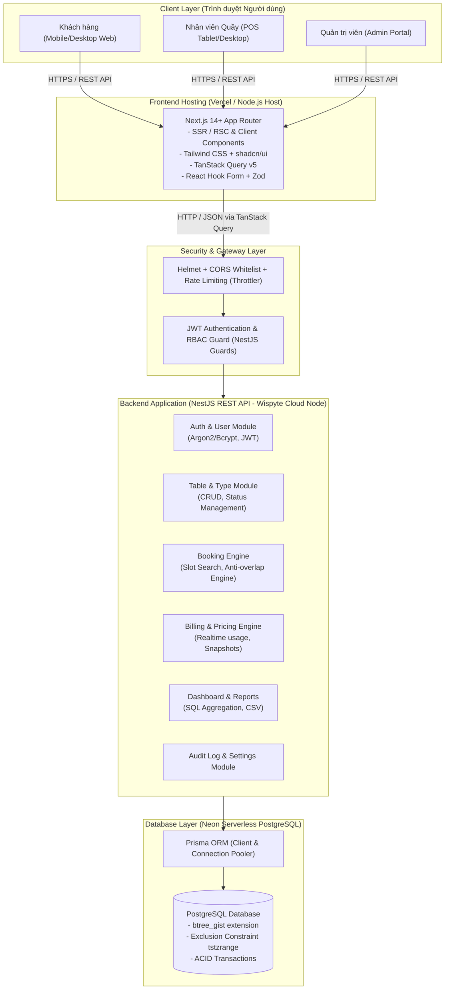
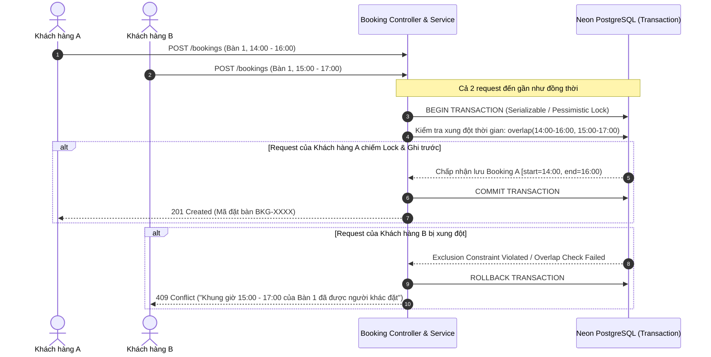
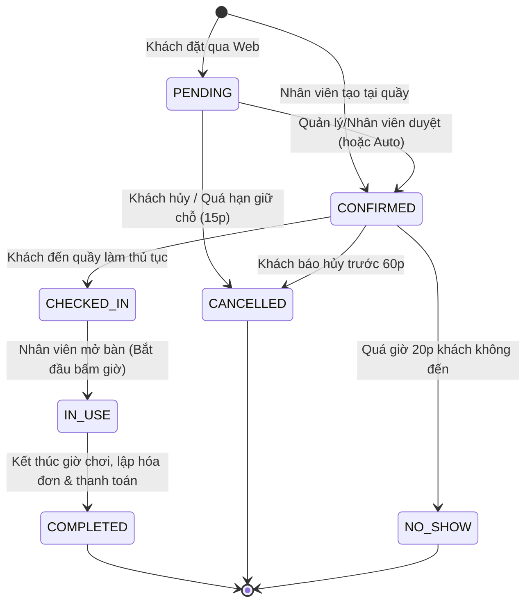

# KIẾN TRÚC HỆ THỐNG - HỆ THỐNG QUẢN LÝ ĐẶT BÀN BI-DA

---

## 1. TỔNG QUAN KIẾN TRÚC

Hệ thống được thiết kế theo mô hình **Monorepo chuẩn Modular**, tách biệt rõ ràng giữa Backend (NestJS API), Frontend (Next.js App Router) và Thư viện tài liệu / Shared types.



---

## 2. THIẾT KẾ MODULE BACKEND (NESTJS)

Backend được tổ chức theo kiến trúc Domain-Driven Modular của NestJS:
- `apps/api/src/modules/`
  - `auth/`: Đăng ký, đăng nhập, phát hành và làm mới JWT (Access/Refresh token), băm mật khẩu.
  - `users/`: Quản lý thông tin tài khoản người dùng, đổi mật khẩu, phân vai trò.
  - `table-types/`: Quản lý phân loại bàn (Carom, Pool/Lỗ, Snooker), đơn giá niêm yết theo giờ.
  - `tables/`: Quản lý danh sách bàn vật lý, mã bàn (B01, B02...), trạng thái thực tế (`AVAILABLE`, `OCCUPIED`, `MAINTENANCE`), khu vực (VIP, Thường).
  - `bookings/`: Tìm kiếm khung giờ trống, đặt bàn, kiểm tra xung đột thời gian, hủy đặt bàn, chuyển đổi trạng thái.
  - `sessions/`: Quản lý phiên chơi thực tế (bật giờ, tạm dừng, đổi bàn, kết thúc giờ chơi).
  - `services/`: Quản lý menu đồ ăn, nước uống, phụ kiện thuê thêm.
  - `invoices/`: Lập hóa đơn tính tiền bàn thực tế + dịch vụ, áp dụng giảm giá, lưu snapshot đơn giá.
  - `payments/`: Quản lý giao dịch thanh toán (Tiền mặt, Chuyển khoản QR, Thẻ), chống thanh toán lặp.
  - `dashboard/`: Cung cấp số liệu thống kê thời gian thực (Bàn đang hoạt động, doanh thu ngày, tỷ lệ lấp đầy).
  - `reports/`: Xuất báo cáo doanh thu theo dải ngày, lọc theo loại bàn và nhân viên.
  - `audit-logs/`: Ghi vết các sự kiện nhạy cảm (Đổi trạng thái, hủy bàn, sửa giá, thanh toán).
  - `settings/`: Cấu hình thời gian mở cửa, thời gian đặt trước, chính sách hủy bàn.
  - `health/`: Kiểm tra tình trạng kết nối Database và bộ nhớ hệ thống.

---

## 3. CƠ CHẾ CHỐNG TRÙNG LỊCH ĐẶT BÀN (ANTI-OVERLAP CONCURRENCY)

Đây là tính năng cốt lõi sống còn của hệ thống. Xung đột xảy ra khi hai khách hàng cùng gửi yêu cầu đặt cùng một bàn vào các khung giờ giao nhau trong cùng một phần trăm giây.

### 3.1. Sơ đồ xử lý đồng thời (Concurrency Handling Flow)



### 3.2. Cơ chế Exclusion Constraint ở cấp độ PostgreSQL
Hệ thống sử dụng tiện ích mở rộng `btree_gist` của PostgreSQL:
```sql
CREATE EXTENSION IF NOT EXISTS btree_gist;

-- Thêm ràng buộc loại trừ chống trùng lặp khoảng thời gian [start_time, end_time)
-- cho cùng một bàn (billiard_table_id) trên các trạng thái đang giữ chỗ:
ALTER TABLE bookings
ADD CONSTRAINT booking_no_overlap_exclusion
EXCLUDE USING gist (
  billiard_table_id WITH =,
  tstzrange(start_time, end_time, '[)') WITH &&
)
WHERE (status IN ('PENDING', 'CONFIRMED', 'CHECKED_IN', 'IN_USE'));
```
- Toán tử `[)`: Điểm đầu đóng, điểm cuối mở. Nhờ đó, nếu lượt đặt 1 kết thúc lúc `15:00` và lượt đặt 2 bắt đầu đúng lúc `15:00`, `tstzrange('14:00', '15:00', '[)') && tstzrange('15:00', '16:00', '[)')` sẽ trả về `FALSE` (hợp lệ, không bị trùng).
- Điều kiện `WHERE (status IN ...)`: Khi một lượt đặt bị `CANCELLED` hoặc `COMPLETED`, ràng buộc không còn giữ chỗ trên khoảng thời gian đó, giải phóng hoàn toàn cho các lượt đặt mới.

---

## 4. QUY TRÌNH NGHIỆP VỤ BÀN VÀ THANH TOÁN (LIFECYCLE FLOW)



