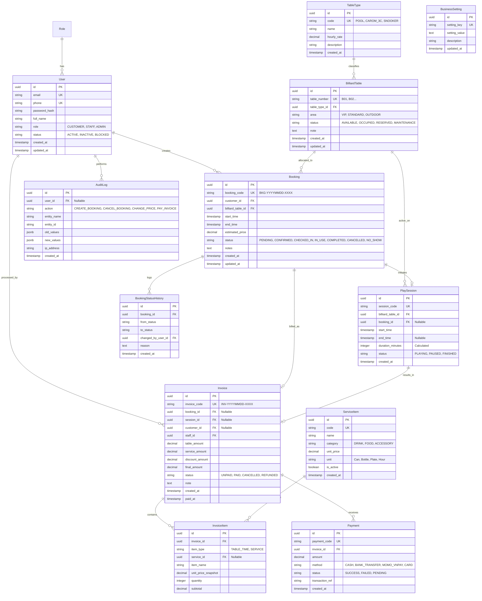

# THIẾT KẾ CƠ SỞ DỮ LIỆU & ERD - HỆ THỐNG QUẢN LÝ ĐẶT BÀN BI-DA

---

## 1. SƠ ĐỒ THỰC THỂ LIÊN KẾT (MERMAID ERD)

---

## 2. QUY TẮC RÀNG BUỘC TOÀN VẸN VÀ CHỈ MỤC (INDEXES & CONSTRAINTS)

1. **Ràng buộc loại trừ (Exclusion Constraint):**
   - Ràng buộc `booking_no_overlap_exclusion` ngăn chặn trùng lặp thời gian `tstzrange(start_time, end_time, '[)')` cho cùng `billiard_table_id` khi trạng thái thuộc nhóm giữ chỗ (`PENDING`, `CONFIRMED`, `CHECKED_IN`, `IN_USE`).
2. **Chỉ mục tăng tốc tìm kiếm bàn trống:**
   - `CREATE INDEX idx_bookings_table_time ON bookings (billiard_table_id, start_time, end_time);`
   - `CREATE INDEX idx_bookings_customer ON bookings (customer_id, status);`
   - `CREATE INDEX idx_invoices_created_at ON invoices (created_at, status);`
3. **Độ chính xác tiền tệ:**
   - Các trường tiền (`hourly_rate`, `estimated_price`, `table_amount`, `service_amount`, `discount_amount`, `final_amount`, `unit_price_snapshot`) dùng kiểu `DECIMAL(12, 2)` (hoặc `NUMERIC(12, 2)`), đảm bảo không gặp sai số dấu phẩy động (Floating-point error) như khi dùng `FLOAT` hoặc `DOUBLE`.
4. **Xóa an toàn (Integrity on Delete):**
   - `ON DELETE RESTRICT` đối với `BilliardTable` nếu còn `Booking` hoặc `PlaySession` liên quan.
   - `ON DELETE RESTRICT` đối với `User` nếu đã có `Invoice` hoặc `Booking`.
   - `ON DELETE CASCADE` cho `InvoiceItem` khi xóa hóa đơn dự thảo (`UNPAID`), nhưng hóa đơn đã `PAID` được bảo vệ không thể xóa.

