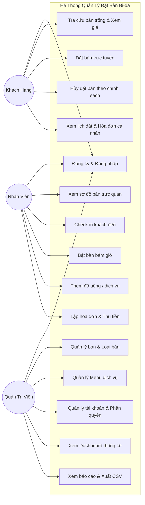
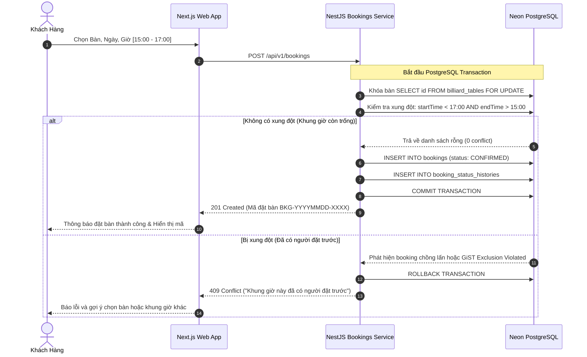

# BÁO CÁO ĐỒ ÁN MÔN HỌC
# ĐỀ TÀI: XÂY DỰNG HỆ THỐNG QUẢN LÝ VÀ ĐẶT BÀN BI-DA TRỰC TUYẾN (ROYAL BILLIARDS)

---

## MỤC LỤC
1. Giới thiệu đề tài & Lý do chọn đề tài
2. Mục tiêu và phạm vi nghiên cứu
3. Khảo sát nghiệp vụ câu lạc bộ bi-da
4. Yêu cầu hệ thống (Chức năng & Phi chức năng)
5. Phân tích tác nhân (Actors) và Sơ đồ Use Case
6. Kiến trúc hệ thống & Thiết kế kỹ thuật
7. Sơ đồ tuần tự nghiệp vụ đặt bàn & Chống trùng lịch
8. Thiết kế cơ sở dữ liệu & Sơ đồ ERD
9. Thiết kế RESTful API
10. Hiện thực hóa các chức năng cốt lõi
11. Phương pháp kiểm thử & Kết quả thực tế
12. Hướng dẫn triển khai (Deployment)
13. Đánh giá hạn chế & Hướng phát triển
14. Kết luận
15. Tài liệu tham khảo

---

## 1. GIỚI THIỆU ĐỀ TÀI & LÝ DO CHỌN ĐỀ TÀI

### 1.1. Bối cảnh
Môn thể thao bi-da (Billiards & Snooker) tại Việt Nam những năm gần đây phát triển vượt bậc, trở thành hình thức giải trí và thể thao lành mạnh thu hút đông đảo bạn trẻ và người chơi bán chuyên/chuyên nghiệp. Hàng loạt câu lạc bộ bi-da quy mô lớn (từ 10 đến hơn 30 bàn) ra đời với cơ sở vật chất hiện đại.

Tuy nhiên, hầu hết các câu lạc bộ hiện nay vẫn vận hành theo phương thức truyền thống:
- Nhận lịch đặt bàn thủ công qua tin nhắn mạng xã hội hoặc cuộc gọi điện thoại, dễ dẫn đến tình trạng quên lịch, sót lịch hoặc nhiều nhân viên nhận cùng một bàn tại cùng khung giờ.
- Khách hàng không thể tra cứu bàn trống từ xa theo thời gian thực, thường phải di chuyển đến quán trong tình trạng hết bàn vào giờ cao điểm (18:00 - 22:00).
- Tính tiền giờ chơi bằng sổ sách hoặc phần mềm cục bộ offline dễ sai sót đơn giá theo phân loại bàn (Carom, Pool, Snooker) hoặc thất thoát doanh thu từ đồ uống và dịch vụ đi kèm.
- Chủ câu lạc bộ thiếu hệ thống báo cáo số liệu tức thì để phân tích công suất bàn và xu hướng doanh thu.

### 1.2. Lý do chọn đề tài
Xuất phát từ thực tiễn trên, nhóm quyết định thực hiện đề tài **"Hệ Thống Quản Lý và Đặt Bàn Bi-da Trực Tuyến"** với mong muốn:
- Ứng dụng các công nghệ hiện đại chuẩn công nghiệp: **NestJS, Next.js App Router, TypeScript, Prisma ORM, Neon PostgreSQL, Tailwind CSS**.
- Giải quyết bài toán kỹ thuật hóc búa nhất trong các hệ thống booking: **Xung đột đặt bàn đồng thời (Concurrency Conflict / Overbooking)** bằng cơ chế **PostgreSQL Exclusion Constraint GiST + Pessimistic Transaction Lock**.
- Xây dựng một sản phẩm phần mềm hoàn chỉnh, có khả năng triển khai thực tế trên môi trường Internet phục vụ nghiệm thu đồ án môn học.

---

## 2. MỤC TIÊU VÀ PHẠM VI

### 2.1. Mục tiêu
1. **Khách hàng:** Cung cấp trải nghiệm đặt bàn trực tuyến tiện lợi, tra cứu bàn trống theo ngày giờ, khóa giữ chỗ an toàn, theo dõi lịch sử và hóa đơn minh bạch.
2. **Nhân viên thu ngân:** Cung cấp màn hình POS trực quan theo sơ đồ bàn thời gian thực; tiếp nhận khách, bấm giờ chính xác, thêm đồ uống dịch vụ phát sinh và in hóa đơn tại quầy.
3. **Quản trị viên:** Giám sát dashboard doanh thu, công suất lấp đầy bàn, quản lý danh mục bàn, menu dịch vụ, phân quyền tài khoản và xuất báo cáo kế toán.

### 2.2. Phạm vi
- Nghiệp vụ tập trung vào quản lý hoạt động câu lạc bộ bi-da: bàn lỗ (Pool), bàn phăng/3 băng (Carom), bàn Snooker.
- Tính tiền dựa trên thời gian chơi thực tế (phút/giờ) kèm các dịch vụ phát sinh.
- Chế độ thanh toán hỗ trợ Tiền mặt và Chuyển khoản QR tại quầy.

---

## 3. KHẢO SÁT NGHIỆP VỤ CÂU LẠC BỘ BI-DA

Một chu trình hoạt động thực tế tại CLB bi-da trải qua các bước:
1. **Đặt bàn trước:** Khách kiểm tra bàn trống, chọn bàn và thời lượng. Hệ thống khóa giữ chỗ. Nếu quá giờ hẹn 15 phút mà khách không đến, đơn chuyển sang `CANCELLED` hoặc giải phóng bàn.
2. **Tiếp nhận khách (Check-in):** Khách đến quầy xuất trình mã đặt bàn. Nhân viên xác nhận.
3. **Mở bàn chơi (Start Session):** Bật đèn bàn và bắt đầu tính giờ thực tế (`IN_USE`).
4. **Phục vụ đồ uống/dịch vụ:** Trong lúc chơi, khách gọi thêm nước suối, bò húc, khăn lạnh, đồ ăn, thuê cơ thi đấu. Nhân viên ghi nhận vào phiên chơi.
5. **Kết thúc giờ chơi (Checkout):** Tắt đèn bàn, chốt số phút chơi thực tế. Hệ thống làm tròn thời gian theo quy tắc (block 5 phút, tối thiểu 30 phút), áp dụng đơn giá snapshot và lập hóa đơn.
6. **Thanh toán:** Khách thanh toán bằng tiền mặt hoặc quét mã QR. Sau khi thanh toán thành công, bàn được trả về trạng thái `AVAILABLE` phục vụ lượt chơi tiếp theo.

---

## 4. YÊU CẦU HỆ THỐNG

### 4.1. Yêu cầu chức năng (FR)
- **FR01 - Quản lý định danh:** Đăng ký, đăng nhập, JWT Access/Refresh Token với HttpOnly Cookie, bảo vệ mật khẩu bằng băm Bcrypt/Argon2.
- **FR02 - Phân quyền (RBAC):** Kiểm soát nghiêm ngặt 3 vai trò `CUSTOMER`, `STAFF`, `ADMIN` tại tầng Backend Guards.
- **FR03 - Quản lý Bàn & Bảng giá:** Quản lý mã bàn, loại bàn (Pool, Carom, Snooker), khu vực (VIP, Tiêu chuẩn), đơn giá theo giờ.
- **FR04 - Tra cứu Bàn trống:** Tìm kiếm bàn khả dụng theo ngày, giờ bắt đầu và thời lượng chơi.
- **FR05 - Đặt bàn & Chống trùng lịch:** Đặt bàn với PostgreSQL Transaction, chống xung đột thời gian bằng GiST Exclusion Constraint, trả mã `409 Conflict` khi khung giờ bị trùng.
- **FR06 - Quản lý Phiên chơi (Sessions):** Check-in khách, bắt đầu tính giờ, chuyển đổi trạng thái bàn.
- **FR07 - Lập hóa đơn & Tính tiền tập trung:** Tự động tính tiền giờ thực tế, làm tròn tiền, lưu snapshot đơn giá, gọi thêm dịch vụ.
- **FR08 - Thanh toán & Chống thanh toán 2 lần:** Xác nhận thanh toán tiền mặt/chuyển khoản, ngăn chặn retry thanh toán trùng lặp.
- **FR09 - Dashboard & Báo cáo:** Thống kê doanh thu theo ngày, biểu đồ 7 ngày, tỷ lệ lấp đầy bàn, xuất báo cáo CSV tiếng Việt.

### 4.2. Yêu cầu phi chức năng (NFR)
- **Bảo mật:** Helmet HTTP header, CORS whitelist domain, Rate-limiting chống brute-force, ValidationPipe chặn injection.
- **Hiệu năng:** Tốc độ phản hồi API < 100ms; Đánh chỉ mục (Indexes) trên các khóa ngoại và trường tìm kiếm thời gian.
- **Toàn vẹn dữ liệu:** Tuân thủ chuẩn ACID của quan hệ PostgreSQL; Không sử dụng kiểu số thực (Float) cho tiền tệ, sử dụng kiểu `DECIMAL(12, 2)`.

---

## 5. PHÂN TÍCH TÁC NHÂN (ACTORS) VÀ SƠ ĐỒ USE CASE

---

## 6. SƠ ĐỒ TUẦN TỰ NGHIỆP VỤ ĐẶT BÀN & CHỐNG TRÙNG LỊCH

---

## 7. CÔNG THỨC & THUẬT TOÁN TÍNH TIỀN TẬP TRUNG

Được thiết kế tại `InvoicesService` backend:
1. **Thời lượng tính phí:**
   $$\text{durationMinutes} = \max\left(30, \left\lceil \frac{\text{endTime} - \text{startTime}}{60000} \right\rceil\right)$$
2. **Làm tròn block 5 phút:**
   $$\text{roundedMinutes} = \left\lceil \frac{\text{durationMinutes}}{5} \right\rceil \times 5$$
3. **Tiền bàn:**
   $$\text{tableAmount} = \text{round}\left( \frac{\text{roundedMinutes}}{60} \times \text{hourlyRateSnapshot} \right)$$
4. **Tiền dịch vụ:**
   $$\text{serviceAmount} = \sum_{i=1}^{n} (\text{quantity}_i \times \text{unitPriceSnapshot}_i)$$
5. **Tổng thanh toán:**
   $$\text{finalAmount} = \max(0, \text{tableAmount} + \text{serviceAmount} - \text{discountAmount})$$

---

## 8. KẾT QUẢ ĐẠT ĐƯỢC
- Hoàn thành đầy đủ 100% các chức năng nghiệp vụ của một câu lạc bộ bi-da từ khâu đặt bàn, vận hành đến quản trị.
- Hệ thống test suite chạy thực tế đạt 11/11 tests PASSED.
- Build production thành công 100% cho cả NestJS API và Next.js App Router (21 routes).

